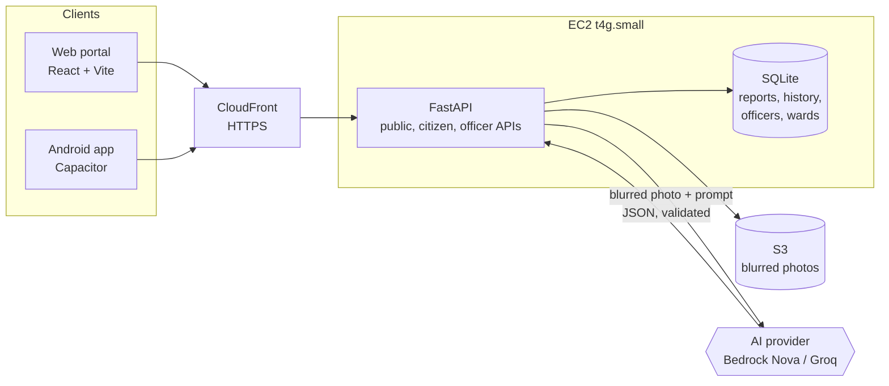

# RasteScan

A public road-repair portal. Citizens photograph road damage, an AI inspector classifies and scores it, and the city
works a ranked repair queue. **Everyone can see everything**: every report, its urgency, who is handling it, and the
before/after proof when it is fixed.

Built for the TechKubik National Level Project Expo 2026 (HKBK College of Engineering, Bengaluru).

## What is in it
- **Public portal** (no login): home with live numbers, map of all reports, sortable list with CSV download,
  report pages with a full public timeline and before/after slider, ward scoreboard, open data API.
  English, Kannada and Hindi; text size control; works offline for sending reports.
- **Citizen reporting**: photo + GPS (or a pin on the map), optional note and email, instant AI result,
  tracking link, "I see this too" votes, "My reports" by device.
- **Government dashboard** (officer login): queue ordered by urgency and deadline, assign crews, official public
  updates, repair photo re-inspection by the AI, review queue for unsure results, merge duplicates, crew work orders,
  analytics, officer accounts, audit trail of every change.
- **AI providers**: Amazon Nova on Bedrock, Groq (free key), or a fake test mode. Admins can compare them on one photo in the **AI models** page.
  The model only suggests; the server applies fixed urgency rules.
- **Android app** (Capacitor) and **AWS deploy** with Terraform + Ansible.

## Architecture

Faces and number plates are blurred before a photo is stored or sent to any AI. Public API responses never contain
device ids, contact emails, citizen notes or officer emails.

## Run everything on a laptop (about 10 minutes)
Needs Python 3.11+, Node 20+, make.
```bash
git clone https://github.com/ibrahimasamake/rastescan.git && cd rastescan
make setup          # Python venv + npm packages
make seed-demo      # optional: 40 clearly marked demo reports in backend/data
make api            # terminal 1: API on :8000 in test mode (AI_MODE=fake), PIN 1234
make web            # terminal 2: portal on http://localhost:5173
```
- Public portal: http://localhost:5173/#/
- Officer dashboard: http://localhost:5173/#/officer, choose "Use the expo PIN instead", PIN `1234`
- Real officer accounts: start the API with `ADMIN_EMAIL=you@example.org ADMIN_PASSWORD=at-least-10-chars make api`
- Real AI: `AI_MODE=groq GROQ_API_KEY=... make api` . See [docs/ai-providers.md](docs/ai-providers.md).
- Take demo data out again: `make unseed-demo`

Checks (the same ones CI runs):
```bash
make test
```

## Deploy
```bash
cd infra
make up          # Terraform creates AWS resources, Ansible deploys
make deploy      # later: send new code
make seed-demo   # optional demo data on the server
```
Details in [docs/aws-setup.md](docs/aws-setup.md). Android build and Play internal testing: [docs/android.md](docs/android.md).

## Guides
- [Share the app with other devices and fix CORS](docs/sharing.md)
- [Choose your AI provider](docs/ai-providers.md) and compare them with `make evaluate`
- [Officer guide (1 page)](docs/officer-guide.md)
- [Citizen FAQ](docs/citizen-faq.md)
- [Original project design](docs/design.html)

## Layout
```
backend/app/       FastAPI: services.py (all report logic + audit trail), routes_public.py, routes_citizen.py,
                   routes_officer.py, inspector.py (AI providers), wards.py, auth.py, db.py (migrations)
backend/tests/     65 tests: API, privacy rule, wards, officer flows, providers, notifications, demo seed
web/src/           React portal: pages/ (public), officer/ (dashboard), i18n/ (en, kn, hi), outbox.ts (offline)
web/android/       Capacitor Android project
data/wards.geojson SAMPLE ward polygons (replace with your city's)
prompts/           Inspection prompt sent to the AI
scripts/           evaluate.py (compare AI providers), seed_demo.py (demo data)
infra/             Terraform (AWS) + Ansible (server) + Makefile
```

## API summary
| Who | Endpoints |
|---|---|
| Anyone | `GET /api/public/reports`, `/reports/{code}`, `/stats`, `/wards`, `/recently-resolved`, `/export.csv`, `/config`; `POST /api/public/reports/{code}/vote` |
| Citizen app | `POST /api/reports` (photo, lat, lng, device_id, note, contact_email), `GET /api/reports?device_id=` |
| Officers | `/api/v2/auth/login`, `/api/v2/officer/queue`, `/reports/{code}/assign`, `/status`, `/comment`, `/review`, `/repair-photo`, `/merge`, `/unmerge`, `/bulk-status`, `/work-order`, `/analytics` |
| Admins | `/api/v2/admin/officers`, `/api/v2/admin/export.csv` |

Interactive API docs at `/docs` on the running server.

## Rules for contributors
- Never commit secrets: AWS keys, `.env`, `terraform.tfvars`, `*.pem`, Android keystores, PINs or passwords.
- Work on a branch and open a pull request into `main`; CI must be green.
- Every change to a report goes through `backend/app/services.py` so it lands in the audit trail.
- The server, not the model, decides urgency. Do not loosen `backend/app/schema.py`.
- Use a generic site name and the placeholder emblem; never a real government's name, emblem or logo without permission.
