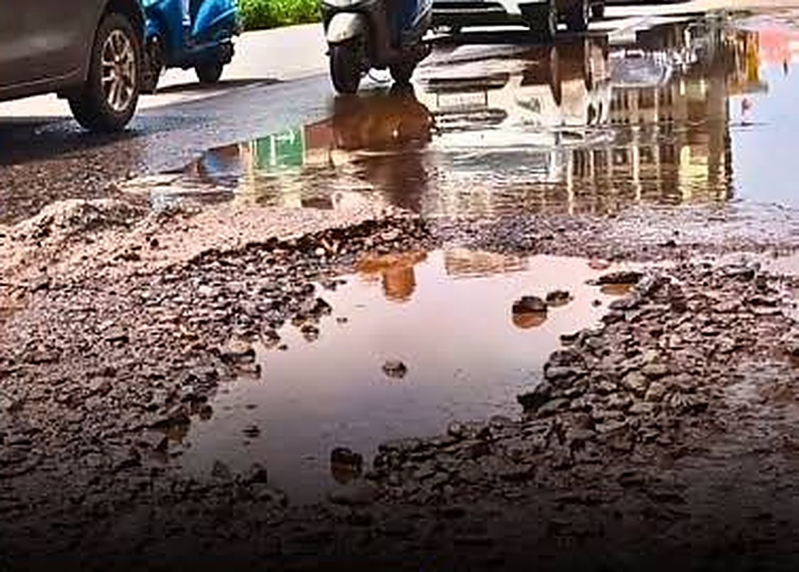
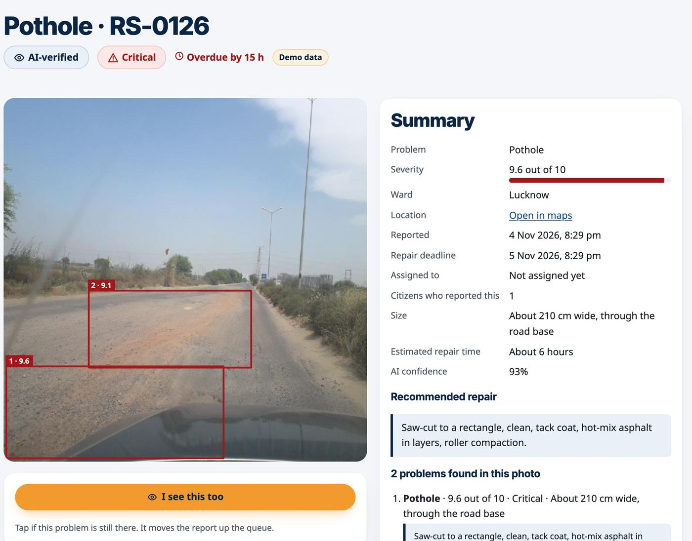
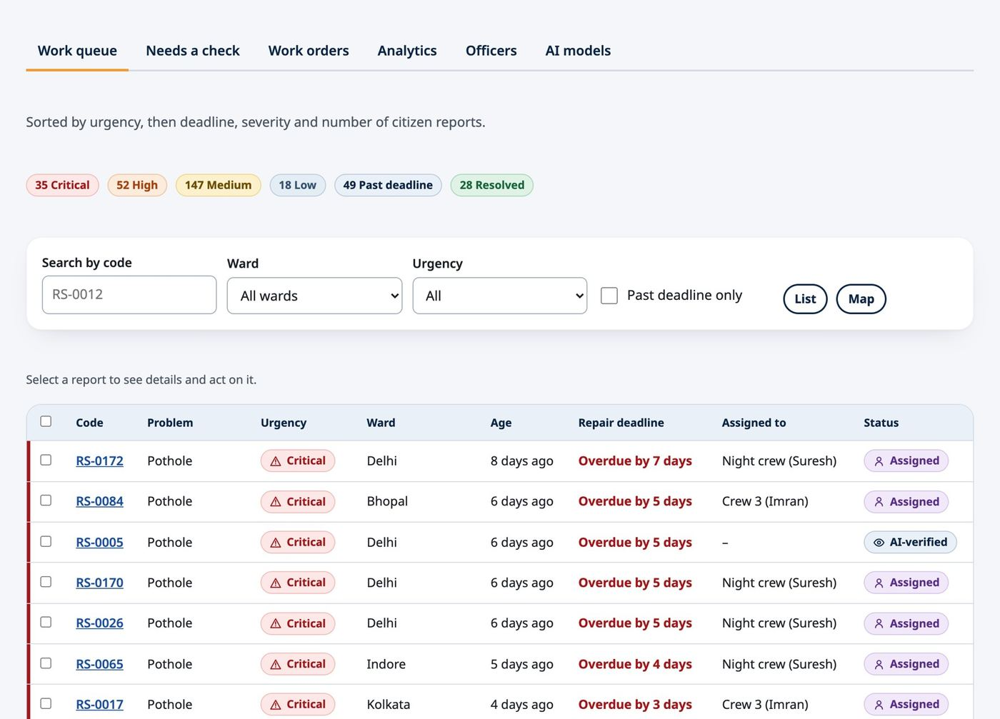
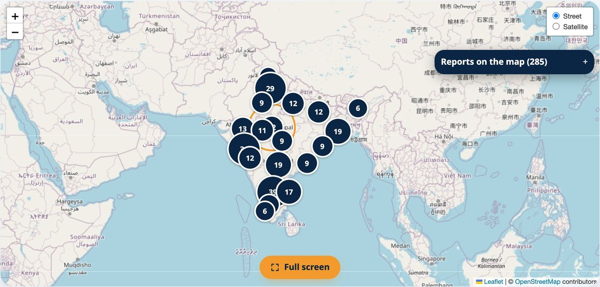
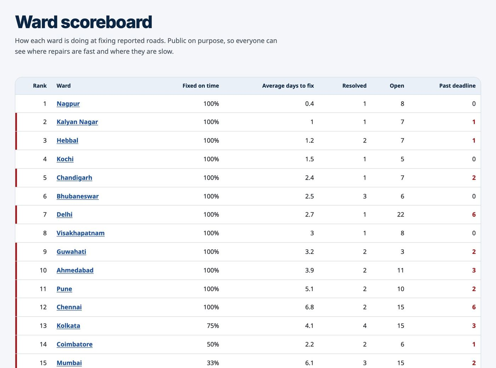
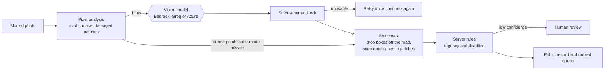
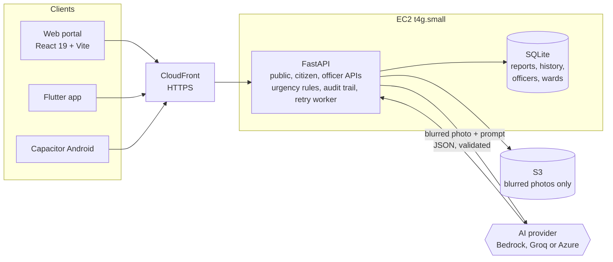
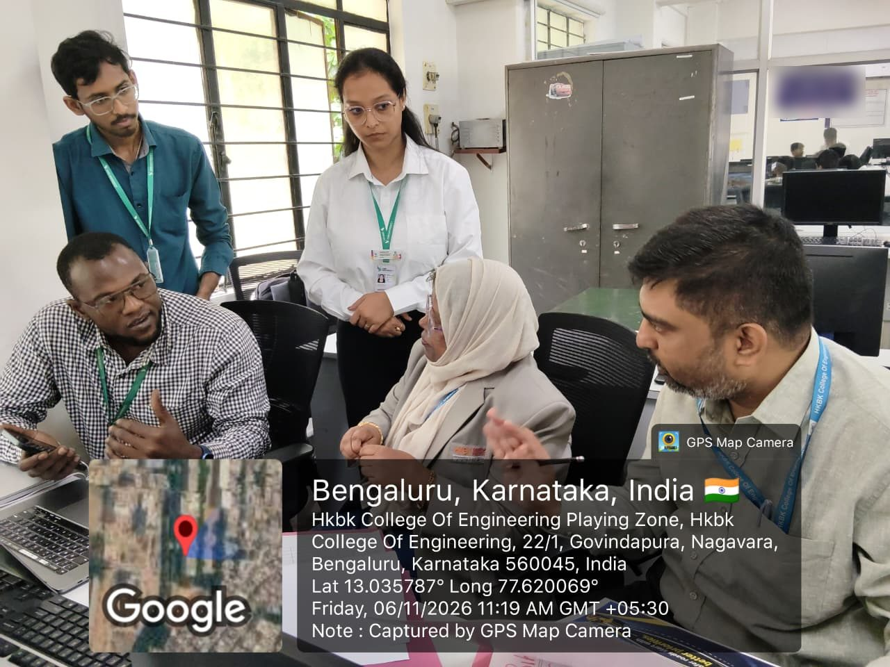
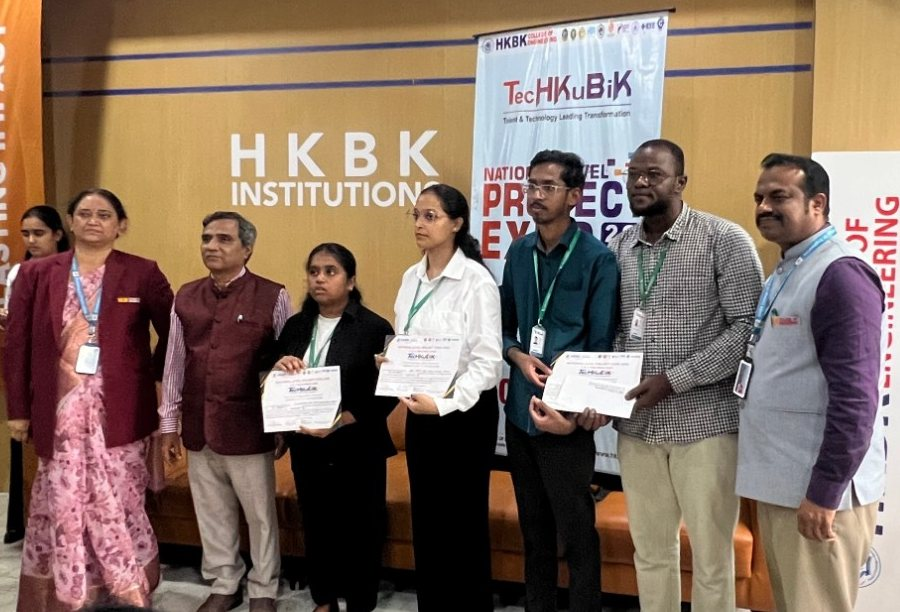

# RasteScan

**Report it. Rank it. Repair it. In public.**

A citizen photographs road damage. An AI inspector finds it and scores it. The server sets the urgency and the deadline, the
city works one ranked repair queue, and anyone can check every step, from the report to the before and after photos.

[](https://github.com/ibrahimasamake/rastescan/actions/workflows/ci.yml)

[Live demo](https://dev.samibrahima.tech) (test mode, demo data, may be offline) ·
[The full story](https://samibrahima.tech/rastescan.html) ·
[Run it on your laptop](#run-it-on-your-laptop) ·
[What is not proved yet](#where-it-stands)

**Best social innovative project** at the TechKubik National Level Project Expo 2026, HKBK College of Engineering, Bengaluru,
with a cash prize. Built by Aaditi Varsha, Chaitanya, Ibrahima and Vishnu, MCA students at CMR University.

## Why it exists



<sub>Still from a news video; rights remain with the publisher. Only the pothole half is shown: the injured woman, the channel logo and the headline are cropped out.</sub>

RasteScan starts from a news thumbnail: a woman hurt by a pothole, under the headline "Another Victim of Neglected Roads".
*Another* is accurate.

| 2020 to 2024, India | |
|---|---|
| People killed in pothole-related accidents | **9,438** |
| Rise in yearly deaths, 2020 to 2024 (1,555 to 2,385) | **53%** |
| Pothole-related accidents | **23,056** |
| People injured | **19,956** (9,670 grievously) |

<sub>Ministry of Road Transport and Highways, written reply to Parliament, from state police reports, via [Outlook India with PTI](https://www.outlookindia.com/national/pothole-deaths-in-india-rise-53-in-5-years-9438-killed-between-2020-2024) (14 Feb 2026). These only count what police recorded: Andhra Pradesh, Bihar and Goa reported none in five years.</sub>

Road damage reaches a city as a WhatsApp photo, a social media post or a call to the ward office. Someone has to work out what
each one is and how dangerous it is, while an open manhole and a hairline crack wait in the same pile. Then the results come
back as a total. In August 2026, Bengaluru's civic body told the Karnataka High Court it had repaired
[10,202 potholes since April](https://www.livelaw.in/high-court/karnataka-high-court/karnataka-high-court-pothole-crisis-bbmp-claims-potholes-545776),
and the court asked for an affidavit on the mechanism behind it. A total cannot tell you whether your road was one of them.

So RasteScan has two jobs: **sort the pile by danger, and put every step where anyone can check it.**

## One report, from photo to proof

1. **Report.** A photo and a location, no login. English, Kannada or Hindi. With no signal, the report waits in an offline queue.
2. **Protect.** Faces and number plates are blurred before the photo is stored or sent to any AI.
3. **Inspect.** Pixel analysis finds the road surface and damaged patches first. A vision model gets them as hints, then its boxes are checked against the pixels.
4. **Rank.** The server sets urgency and deadline. Officers work one queue: urgency, then deadline, then severity, then how many citizens reported the spot.
5. **Prove.** The crew uploads a photo from the site and the AI checks it. Damage gone: **Resolved**, with public before and after photos. Damage still there: reopened and assigned again.

| Public report page | Officer work queue |
|---|---|
|  |  |

| Public map | Ward scoreboard |
|---|---|
|  |  |

<sub>All screens show demo data. RS-0126 is an RDD2022 photo with the dataset's human labels and a made-up place and date: it shows the result format, not model output.</sub>

## What is in it

**Public portal, no login.** Home with live numbers, map of every report, sortable list with CSV download, report pages with a
public timeline and before/after slider, ward scoreboard, Impact page with repair costs and a live activity ticker, open data
API. Text size control, English, Kannada and Hindi.

**For citizens.** Photo and GPS (or a pin on the map), optional note and email, instant AI result, tracking link,
"I see this too" votes, "My reports" by device. PIN code and state on every report.

**For officers.** Ranked queue, crew assignment, official public updates, re-inspection of repair photos, review queue for unsure
results, duplicate merging, printable work orders, analytics, officer accounts, and an audit trail of every change.

**For admins.** An AI models page that runs models on one photo side by side and picks the live one.

**Apps.** A Flutter app for citizens and officers ([`mobile/`](mobile/README.md)) and a Capacitor build of the portal ([`docs/android.md`](docs/android.md)).

## The model suggests. The server decides.

The model returns a severity score. Plain code in [`backend/app/schema.py`](backend/app/schema.py) does the rest:

| Urgency | Rule | Repair deadline |
|---|---|---|
| Critical | Severity 9 or more, or **any** open manhole | 24 hours |
| High | Severity 7 to 8.9 | 48 hours |
| Medium | Severity 4 to 6.9 | 7 days |
| Low | Severity below 4 | 90 days |

- **Unsure goes to a person.** Under 60% confidence, a report waits for human review before it is published.
- **Bad answers are rejected.** Every answer must pass a strict schema. If it fails, the server retries once, then asks the citizen to try again.
- **A busy AI loses nothing.** The report is saved as waiting and a background worker finishes it. Nothing unchecked is published.
- **The same photo is not inspected twice.** Results are cached by photo hash, model and prompt, so editing the prompt invalidates the cache.
- **The price is arithmetic.** The model supplies measurements; [`costing.py`](backend/app/costing.py) applies one table of unit rates. These are budgeting estimates, not tenders.



## Public by default, private where it matters

| Anyone can see | Never shown to the public |
|---|---|
| Every report and its blurred photo | Device ID |
| Problem type, severity, urgency, deadline | Contact email |
| Ward, assignee, status timeline | A citizen's private note |
| Before and after photos, cost, map, CSV | Officer email addresses |

Tests in [`backend/tests/`](backend/tests/) guard this line. Anything leaving the server for anonymous readers goes through
`public_item` or `public_detail`.

## Where it stands

**Working today:** the full flow from report to public proof, the portal in three languages, the officer dashboard, the admin
model comparison, a public demo, Android builds, and 100+ backend tests in CI.

**Not proved yet:**

- **AI accuracy.** Not measured on a labelled set of local photos. The test bench is ready: `make evaluate`.
- **Real use.** No city has used this. The demo reports use RDD2022 photos with made-up places and dates, and carry a Demo badge.
- **The public demo runs in test mode.** Its AI results are sample answers, and the site says so on screen. It is also served through a tunnel from a development machine, not the AWS deployment.
- **Costs and boundaries.** Costs use rough Indian municipal rates. Ward boundaries are samples.

**Next:** label 20 to 30 local photos and run the comparison, replace the demo data with our own Bengaluru cases, pilot with one
ward office using its real boundaries and rates, then measure time to fix and reports verified.

## Architecture



This is the AWS deployment that `infra/` creates. On a laptop the same app runs with local storage and no cloud at all.

| | |
|---|---|
| **Backend** | Python, FastAPI, Pydantic, SQLite, OpenCV, Pillow |
| **Web** | React 19, Vite, TypeScript, Leaflet, GSAP |
| **Mobile** | Flutter, plus a Capacitor build of the portal |
| **AI** | Amazon Bedrock (Nova), Groq, Azure, and a test mode that needs no internet |
| **Platform** | AWS EC2, S3, CloudFront, Terraform, Ansible, GitHub Actions |

## Run it on your laptop

Needs Python 3.11+, Node 20+ and make. No API keys.

```bash
git clone https://github.com/ibrahimasamake/rastescan.git && cd rastescan
make setup       # Python venv and npm packages
make seed-india  # optional: about 200 clearly marked demo reports across 20 Indian cities
make api         # terminal 1: API on :8000 in test mode, PIN 1234
make web         # terminal 2: portal on http://localhost:5173
```

- Public portal: http://localhost:5173/#/
- Officer dashboard: http://localhost:5173/#/officer, then "Use the expo PIN instead", PIN `1234`

### Useful commands

| Command | What it does |
|---|---|
| `make test` | What CI runs: pytest, then eslint, `tsc -b` and `vite build` |
| `make seed-demo` | 40 drawn demo reports |
| `make seed-india` | About 200 demo reports from RDD2022 photos, no AI run |
| `make unseed-demo` | Removes every demo report |
| `REPORTS_PER_HOUR=2000 make api`, then `make live-demo` | Keeps a running API busy: new reports, assignments, fixes |
| `make evaluate` | Compares AI providers on `test-photos/` (`PROVIDERS=groq,bedrock`) |
| `make share` | Builds the web app and serves it with the API on :8000 for other devices |
| `make tunnel` | A public https link to `make share` (needs cloudflared) |
| `make apk` | Builds the Flutter app and publishes it at `/api/public/rastescan.apk` |
| `make android` | Builds the portal for the Capacitor Android project |

One backend test: `cd backend && .venv/bin/python -m pytest tests/test_officer.py::test_name -q`

### Going beyond test mode

```bash
AI_MODE=groq GROQ_API_KEY=... make api                         # or AI_MODE=azure, AI_MODE=bedrock
ADMIN_EMAIL=you@example.org ADMIN_PASSWORD=at-least-10-chars make api   # real officer accounts
```

Every setting is an environment variable, documented in [`backend/.env.example`](backend/.env.example). Choosing a provider:
[`docs/ai-providers.md`](docs/ai-providers.md).

## Deploy

```bash
cd infra
make up          # Terraform creates the AWS resources, Ansible deploys
make deploy      # later: send new code
make seed-demo   # optional demo data on the server
```

Details: [`docs/aws-setup.md`](docs/aws-setup.md).

## API summary

Interactive docs are at `/docs` on a running server.

| Who | Endpoints |
|---|---|
| Anyone (`/api/public`) | `GET /reports`, `/reports/{code}`, `/reports/{code}/address`, `/stats`, `/impact`, `/activity`, `/wards`, `/recently-resolved`, `/export.csv`, `/config`, `/rastescan.apk`; `POST /reports/{code}/vote` |
| Citizen app | `POST /api/reports` (photo, lat, lng, device_id, note, contact_email); `GET /api/reports?device_id=`; `GET /api/health` |
| Officers (`/api/v2/officer`) | `GET /queue`, `/analytics`, `/assignees`, `/work-order`, `/reports/{code}`; `POST /bulk-status` and, under `/reports/{code}`: `/assign`, `/status`, `/comment`, `/review`, `/repair-photo`, `/rescan`, `/merge`, `/unmerge` |
| Sign-in (`/api/v2/auth`) | `POST /login`, `/logout`; `GET /me` |
| Admins (`/api/v2/admin`) | `/officers`, `/export.csv`, `/models`, `/models/test`, `/models/live` |

## Project layout

```
backend/app/        FastAPI: services.py (all report logic and the audit trail), routes_*.py, inspector.py (AI providers),
                    pixels.py (road and patch detection), schema.py (urgency rules), costing.py, triage.py, imaging.py
                    (blurring), wards.py, geocode.py, db.py (numbered migrations)
backend/tests/      API, privacy rule, wards, officer flows, providers, pixels, costs, notifications, demo seeds
web/src/            React portal: pages/ (public), officer/ (dashboard), i18n/ (en, kn, hi), outbox.ts (offline queue)
web/android/        Capacitor Android project
mobile/             Flutter app: lib/api.dart, lib/officer_api.dart, lib/ui.dart (design system), lib/pages/
data/               Ward polygons (samples) and india-cases/ (RDD2022 demo photos, see ATTRIBUTION.md)
prompts/            The inspection prompt sent to the AI
scripts/            evaluate.py, seed_demo.py, seed_india.py, live_demo.py
infra/              Terraform (AWS), Ansible (server), Makefile
docs/               Guides, the original design and the screenshots used here
```

## How it was built

The first commit is dated 4 November 2026, the day before the expo opened. Three days later there were 61.

- **4 November: the whole shape.** Design, prompt and schema first, then backend, portal, Android wrapper, CI, Terraform and Ansible, the map, officer dashboard, analytics, Kannada and Hindi, and offline reports.
- **5 November: the AI fights back.** Bedrock was locked, so the deploy learned to run in test mode and Groq came in. The Groq model we had chosen was shut down, so we switched. Ollama and a YOLO detector went in overnight and were gone by the afternoon. Azure came in. Then pixel analysis, before and after the model.
- **6 November: people have to use it.** Repair costs and an Impact page, 200 demo reports from real road photos, a Flutter app for citizens and officers, PIN code and state on every report.



<sub>Talking through RasteScan at HKBK College of Engineering, 6 November 2026.</sub>

The expo's rule was "Only working model will be allowed", so the demo is the real system: send a road photo, watch it get
analysed, open the officer queue, assign the job, fix it, and see the public page, map and scoreboard change.

It won best social innovative project, along with a cash prize.



<sub>The team at the prize giving, HKBK College of Engineering, Bengaluru.</sub>

## Guides

- [Share the app with other devices and fix CORS](docs/sharing.md)
- [Choose your AI provider](docs/ai-providers.md)
- [Officer guide (one page)](docs/officer-guide.md)
- [Citizen FAQ](docs/citizen-faq.md)
- [Android: Capacitor build](docs/android.md) and [Flutter app, including Play release steps](mobile/README.md)
- [AWS setup](docs/aws-setup.md)
- [Original project design](docs/design.html)

## Contributing

- Never commit secrets: AWS keys, `.env`, `terraform.tfvars`, `*.pem`, keystores, PINs or passwords.
- Work on a branch and open a pull request into `main`. CI must be green.
- Every change to a report goes through `backend/app/services.py`, so it lands in the audit trail.
- The server, not the model, decides urgency. Do not loosen `backend/app/schema.py`.
- Add interface text to all three dictionaries in `web/src/i18n/`.
- Use a generic site name and the placeholder emblem, never a real government's name, emblem or logo.

## Credits and disclosures

- **Demo road photos:** [RDD2022](https://figshare.com/articles/dataset/RDD2022_-_The_multi-national_Road_Damage_Dataset_released_through_CRDDC_2022/21431547) (Arya, Maeda, Ghosh, Toshniwal and Sekimoto, *Geoscience Data Journal*, 2024). See [`data/india-cases/ATTRIBUTION.md`](data/india-cases/ATTRIBUTION.md).
- **News photos in the Home banner:** the rights belong to their publishers. They are used for a student project demonstration, credited on screen. See [`web/public/banner/CREDITS.md`](web/public/banner/CREDITS.md) before any wider use.
- **Site name and emblem** in the app are generic placeholders, not those of any government body.
- Backlog, cost and scoreboard figures in the screens come from the demo database, not from a real city.
